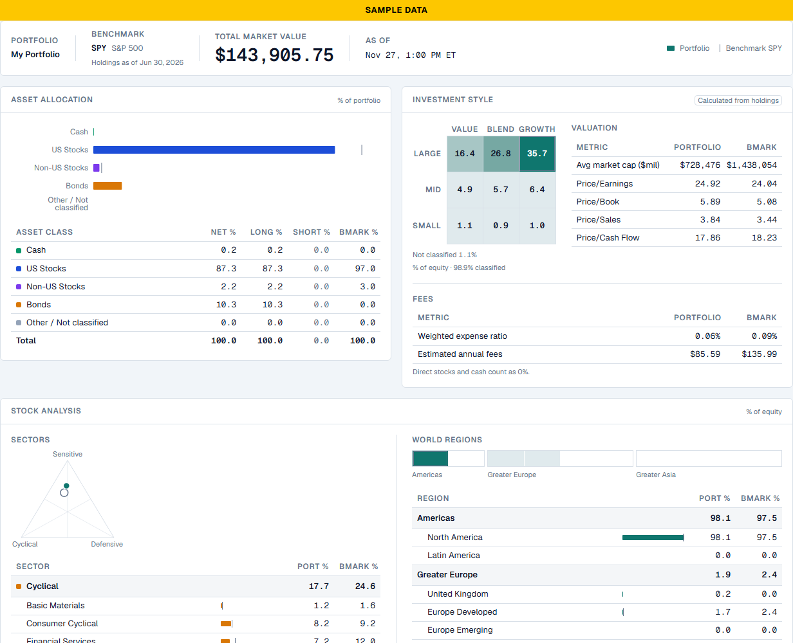
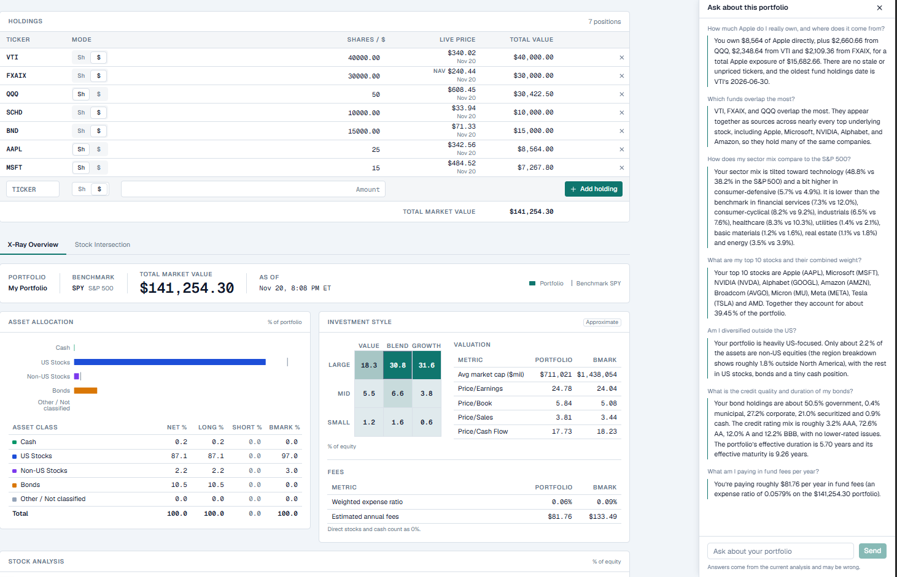
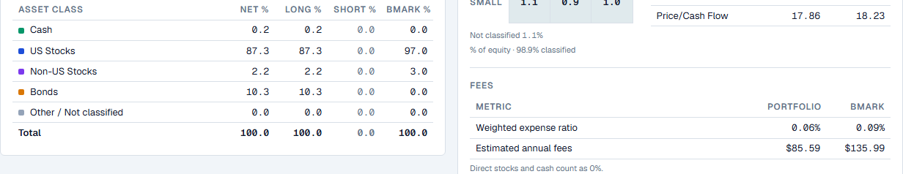

# FolioPrism

[](https://github.com/SM4527/folioprism/actions/workflows/ci.yml)
[](LICENSE)
[](https://github.com/SM4527/folioprism/releases)

A self-hosted portfolio web app. Enter your stocks, ETFs and mutual funds; FolioPrism unpacks each fund into its underlying stocks, aggregates the overlap, and shows:

- **Prism View**, a portfolio look-through — asset allocation, 11 sectors in 3 super-sectors, world regions, 3x3 style box (calculated from holdings), valuation metrics, expense ratio, and bonds, all vs a benchmark (SPY, VTI or AGG).
- **Stock Intersection** — the Top 50 underlying stocks with % of portfolio and $ value, each expandable into the funds it comes from. Child rows always sum exactly to the parent: all aggregation uses `decimal.js` exact decimal arithmetic, so there is no floating-point drift across overlapping funds.
- **AI chat (optional)** — ask questions like "what is my top 10 stock concentration?", answered from the current analysis.

Single user, single portfolio, no account. Data stays on your machine.

**Tech stack:** Next.js 16 (App Router, React 19) and TypeScript 6 with Tailwind v4, shadcn/ui and Recharts; Prisma 7 (`@prisma/adapter-pg`) on PostgreSQL 16; yahoo-finance2 for market data; decimal.js for all money math; Vitest for tests. Runs as two Docker containers (`folioprism-app` on Node 24, `folioprism-db`) with holdings in a named volume. Details in [docs/ARCHITECTURE.md](docs/ARCHITECTURE.md).






<details>
<summary>More screenshots</summary>




</details>

FolioPrism is a personal analysis tool, not investment advice. Market data comes from unofficial Yahoo Finance and Google Finance sources and may be delayed or wrong; fund holdings come from public SEC N-PORT filings.

## Run and stop

Requires Docker (on Windows, run the scripts from Git Bash or WSL). There are two independent stacks. Start with the sample stack; add the personal stack only when you want to enter real holdings.

| | Sample stack (default) | Personal stack (optional) |
|---|---|---|
| Purpose | Try the app, develop, take screenshots | Your real holdings |
| URL | http://localhost:8420 | http://localhost:8430 |
| Scripts | `scripts/start.sh`, `stop.sh`, `restart.sh`, `logs.sh` | `scripts/personal-start.sh`, `personal-stop.sh`, `personal-restart.sh`, `personal-logs.sh` |
| Compose file | `docker/docker-compose.yml` | `docker/compose.personal.yml` |
| Starts with | Sample portfolio | Empty portfolio |
| `data/local/` overlay | Off (`LOCAL_OVERLAY=off`) | On (`LOCAL_OVERLAY=on`) |
| Banner | Yellow "Sample data" | Small blue "Personal" badge |
| Database volume | `folioprism_pgdata` | `folioprism_personal_pgdata` |

Create the shared network once before the first start: `docker network create prism` (other Prism apps, such as SignalPrism, join it to read holdings). The start scripts create it if it is missing.

```bash
./scripts/start.sh                          # build + start, then open http://localhost:8420
./scripts/logs.sh                           # tail app and db logs
./scripts/stop.sh                           # holdings are kept in the folioprism_pgdata volume
./scripts/restart.sh
MARKET_DATA_MODE=mock ./scripts/restart.sh  # offline, curated market data
```

Both listen on loopback only, and PostgreSQL is never exposed to the host. See [Personal stack](#personal-stack-optional) before entering real data.

Docker files live in `docker/`. To run compose by hand from the project root, use `docker compose -f docker/docker-compose.yml ...`; the app container still gets the root `.env`. `MARKET_DATA_MODE` (default `live`) is read from the shell; a value in the root `.env` is honored only by the scripts.

## Reset

`./scripts/reset-db.sh` asks you to type `yes`, then wipes all holdings and re-seeds the sample portfolio.

## AI chat (optional)

Put one or both keys in `.env` in the project root (it is gitignored):

```
GROQ_API_KEY=...        # primary: Groq free tier, openai/gpt-oss-120b
OPENROUTER_API_KEY=...  # fallback: an OpenRouter free (:free) model
CHAT_FALLBACK=off       # off (default) or on; see below
```

The app container reads them from the root `.env`, whether started by `./scripts/start.sh` or by a manual compose run. Keys exported only in the shell are not passed in. Keys stay on the server. Without keys the chat panel is hidden and everything else works.

### What leaves your machine

Each question sends a summary of the current analysis to the chat provider: holdings with dollar values, the top 25 underlying stocks and the Prism View. With real holdings, that is your portfolio. FolioPrism uses only the first configured provider (Groq if its key is set). It tries OpenRouter after a Groq failure only when `CHAT_FALLBACK=on` (default `off`; any other value counts as off). Each reply shows which provider answered, as "via Groq · openai/gpt-oss-120b". Lock down every provider whose key you set before using the chat on a personal stack.

**Groq** (console.groq.com → Settings)

- Data Controls: turn on Global ZDR (Zero Data Retention). Without it, Groq may store inputs and outputs for up to 30 days for reliability and compliance.
- Limits → Allowed models: allow only `openai/gpt-oss-120b`, so a leaked key can't be used with other models.

**OpenRouter** (openrouter.ai/settings/privacy)

- Turn off "Allow free endpoints that train on request data" and "Allow free endpoints that publish prompts". The second lets free providers publish prompts to public datasets.
- Keep paid-endpoint training, the 1% data discount and input/output logging off.
- Or leave `OPENROUTER_API_KEY` unset, or keep `CHAT_FALLBACK=off` with a Groq key set. The chat then never reaches OpenRouter and shows a busy message when Groq fails.

Provider settings change over time; check them against each provider's current docs.

### Fully local alternative

To ask questions without anything leaving your machine, use [Prism MCP](https://github.com/SM4527/prism-mcp) with a local model in LM Studio. It reads FolioPrism's API on localhost and returns percentages only by default.

## Refresh fund holdings

Fund constituents come from SEC N-PORT filings or issuer files, and the style box uses per-stock facts from Yahoo. Both run on the host (Node 24, `npm ci` once):

```bash
./scripts/refresh-funds.sh --public && ./scripts/restart.sh   # public funds into tracked data/, then test and commit
./scripts/refresh-funds.sh && ./scripts/personal-restart.sh   # personal funds into gitignored data/local/
npx tsx scripts/refresh-stock-facts.ts --include-local && ./scripts/personal-restart.sh  # real stock facts, personal stack only
```

Add `--dry-run` to `refresh-stock-facts.ts` to count tickers without any network call. SEC N-PORT parsing, OpenFIGI mapping, size breakpoints, `--allow-older` and scheduling are in [docs/DATA_PIPELINE.md](docs/DATA_PIPELINE.md).

## Import fund holdings (CSV)

On the Stock Intersection tab, the Fund holdings table under the coverage note has an import button for each held fund. Upload an issuer holdings CSV (max 2 MB) with a header row containing a ticker column (`ticker` or `symbol`) and a weight column in percent (for example `weight` or `% of net assets`), plus optional name and as-of date columns. Skipped rows are reported with their line and reason. An import replaces that fund's holdings; the remove button returns the fund to its curated or Yahoo holdings.

## Private curated data

Curated data for your own funds and stocks goes in `data/local/`, which is gitignored. Only the personal stack loads it (`LOCAL_OVERLAY=on`); the default stack, `npm run dev` and `npm run build` ignore it. Copy the layout from `data/local.example/`:

- `funds.json`: fund entries, same layout as `data/mock-funds.json`
- `stocks.json`: direct-stock facts, same layout as `data/mock-stocks.json`
- `cash.json`: extra money-market tickers priced at $1.00 and counted as cash
- `stock-facts.json`: written by `scripts/refresh-stock-facts.ts`; not edited by hand
- `fund-sources.json`: refresh sources for your own funds, same layout as `data/fund-sources.json`

Keep broker exports in `imports/` (gitignored). Enable the pre-push hook with `git config core.hooksPath .githooks`; it blocks files under `data/local/`, `imports/` or `backups/`, CSVs outside `tests/fixtures/`, PNGs outside `docs/screenshots/`, database dumps (`.dump`, `.sql.gz`, and `.sql` outside `prisma/migrations/`), and any ticker from your `data/local/` files that is not in the public fund data.

## Personal stack (optional)

To keep real holdings apart from development, run a second, independent stack on http://localhost:8430 with its own containers (`folioprism-personal-*`) and volume (`folioprism_personal_pgdata`). It loads `data/local/` and starts with an empty portfolio instead of the sample.

Before entering real holdings, enable the pre-push privacy guard once: `git config core.hooksPath .githooks` (see [Private curated data](#private-curated-data)).

```bash
./scripts/personal-start.sh     # build and start
./scripts/personal-stop.sh      # stop; data is kept
./scripts/personal-restart.sh
./scripts/personal-logs.sh
./scripts/personal-backup.sh    # pg_dump to backups/ (gitignored), plus a copy to BACKUP_DIR if set in .env
```

The default scripts never touch the personal stack, and the personal scripts never touch the default one. There is no personal reset script.

## Troubleshooting and offline fallback

The Yahoo and Google Finance endpoints are unofficial and may rate-limit or change without notice. FolioPrism degrades in order instead of failing:

- **Quotes:** cache (15 minutes fresh), then Yahoo, then Google for tickers Yahoo missed, then the stale cache, then the curated `data/mock-quotes.json`. A ticker no source can price shows as unreachable or unknown.
- **Fund holdings:** curated funds in `data/mock-funds.json` first, then the 24-hour cache or Yahoo's top 10, otherwise the fund counts as 100% Other and the coverage note says so.
- **Offline:** `MARKET_DATA_MODE=mock ./scripts/restart.sh` skips every live call and uses only curated data. Direct stocks without curated facts show no sector or style rather than invented values.
- **Fund missing or incomplete:** import the issuer's holdings CSV for that fund (see above), or run `./scripts/refresh-funds.sh`.
- **Holdings without prices:** use dollar mode or the CSV import (`ticker,amount` or `ticker,shares`).
- **Stack won't start:** `./scripts/logs.sh` (or `personal-logs.sh`); the start scripts wait about two minutes for the health check.

## Develop

```bash
npm ci
npm test && npm run lint
```

### Screenshots

`npm run shots` regenerates `docs/screenshots/` from the sample stack on `127.0.0.1:8420` and never touches the personal stack. It fails if the "Sample data" banner is not visible before a capture. It needs:

- the default stack running (`./scripts/start.sh`)
- Node 24 (it runs the `.mts` script directly) and, once, `npx playwright install chromium`
- `GROQ_API_KEY` or `OPENROUTER_API_KEY` in `.env`, otherwise the chat panel is hidden and `ai-chat.png` cannot be captured

## Docs

- `planning/PLAN.md` — product spec
- `docs/ARCHITECTURE.md` — system and UI design
- `docs/DATA_PIPELINE.md` — fund and stock-facts refresh in depth
- `CHANGELOG.md` — release notes

## Built with Claude Code

FolioPrism was designed by Sivanandam Manickavasagam and built with [Claude Code](https://claude.com/claude-code): Claude agents planned, wrote, tested and reviewed the code phase by phase from written specs. The build followed the GSD workflow: research, phased plans, code review and verification for each phase.

## License

MIT. See [LICENSE](LICENSE).