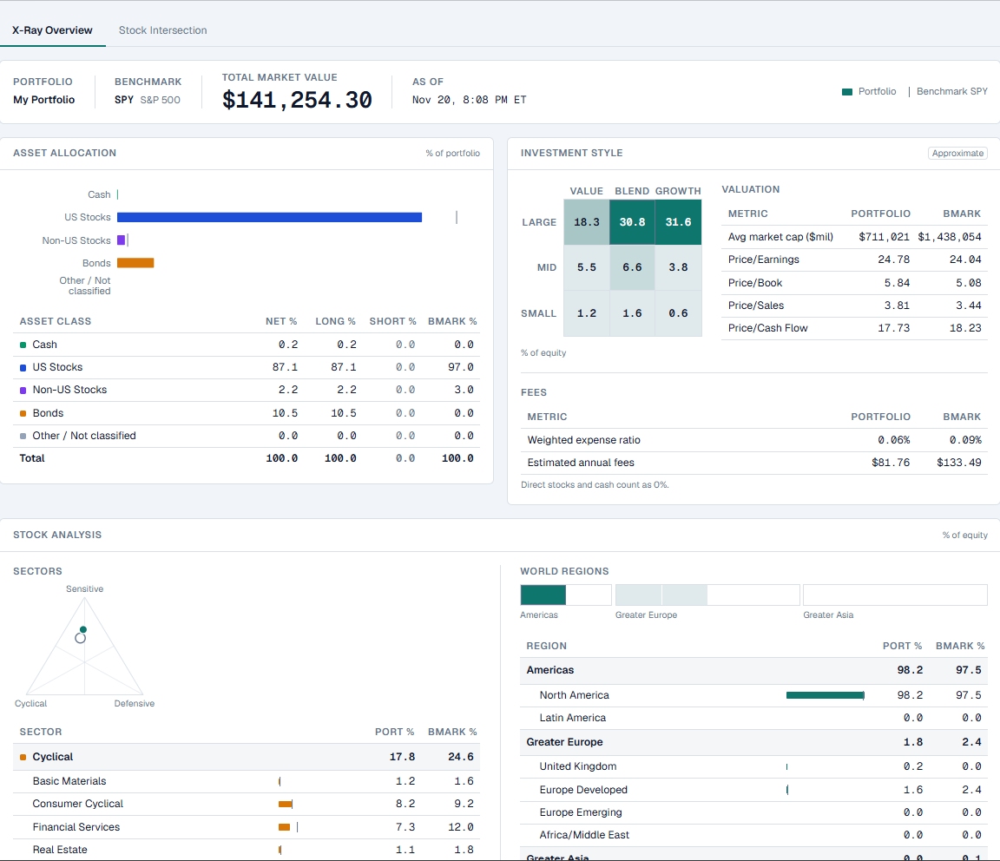
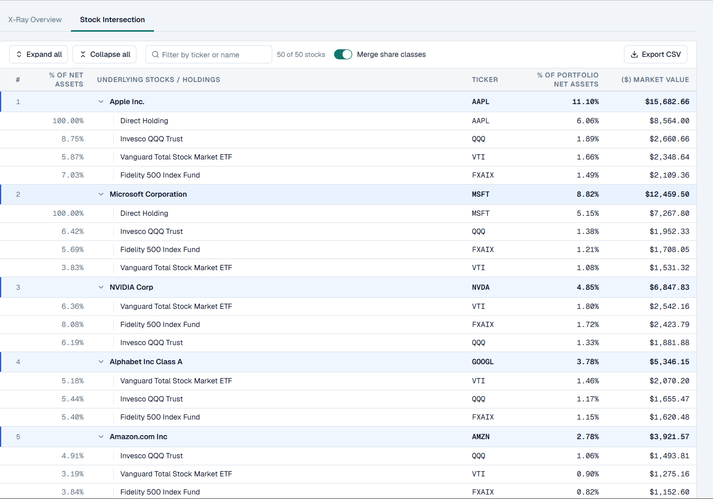
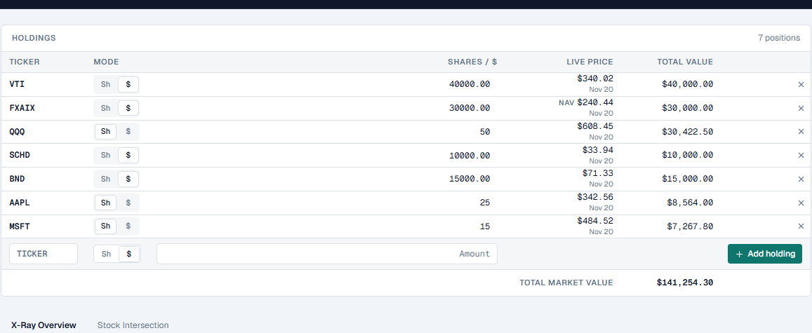
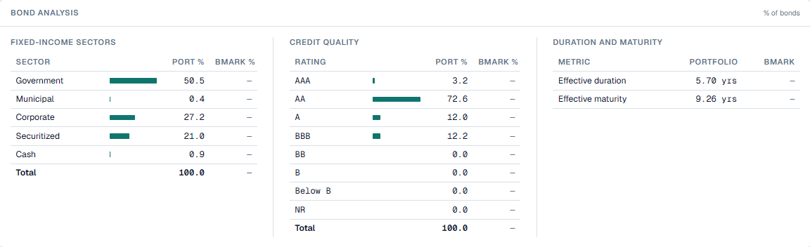

# FolioPrism

A self-hosted portfolio look-through ("X-Ray") web app. Enter your stocks, ETFs and mutual funds; FolioPrism unpacks each fund into its underlying stocks, aggregates the overlap, and shows:

- **X-Ray Overview** — asset allocation, 11 sectors in 3 super-sectors, world regions, 3x3 style box, valuation metrics, expense ratio, and bonds, all vs a benchmark (SPY, VTI or AGG).
- **Stock Intersection** — the Top 50 underlying stocks with % of portfolio and $ value, each expandable into the funds it comes from. Child rows always sum exactly to the parent.
- **AI chat (optional)** — ask questions like "what is my top 10 stock concentration?", answered from the current analysis.

Single user, single portfolio, no account. Data stays on your machine.





<details>
<summary>More screenshots</summary>





</details>

FolioPrism is a personal analysis tool, not investment advice. Market data comes from unofficial Yahoo Finance and Google Finance sources and may be delayed or wrong; fund holdings come from public SEC N-PORT filings.

## Run

Requires Docker (on Windows, run the scripts from Git Bash or WSL).

```bash
./scripts/start.sh                          # build + start, then open http://localhost:8420
./scripts/logs.sh                           # tail app and db logs
MARKET_DATA_MODE=mock ./scripts/restart.sh  # offline, curated market data
```

The app listens on `127.0.0.1:8420`. PostgreSQL is not exposed to the host.

Docker files live in `docker/`. To run compose by hand from the project root, use `docker compose -f docker/docker-compose.yml ...`; the app container still gets the root `.env`. `MARKET_DATA_MODE` (default `live`) is read from the shell; a value in the root `.env` is honored only by the scripts.

## Stop

```bash
./scripts/stop.sh     # holdings are kept in the folioprism_pgdata volume
./scripts/restart.sh
```

## Reset

`./scripts/reset-db.sh` asks you to type `yes`, then wipes all holdings and re-seeds the sample portfolio.

## AI chat (optional)

Put one or both keys in `.env` in the project root (it is gitignored):

```
GROQ_API_KEY=...        # primary: Groq free tier, openai/gpt-oss-120b
OPENROUTER_API_KEY=...  # fallback: an OpenRouter free (:free) model
```

The app container reads them from the root `.env`, whether started by `./scripts/start.sh` or by a manual compose run. Keys exported only in the shell are not passed in. Keys stay on the server. Without keys the chat panel is hidden and everything else works. Free providers may log prompts.

## Refresh fund holdings

`./scripts/refresh-funds.sh` rebuilds `data/mock-funds.json` and `data/cusip-tickers.json` from the funds listed in `data/fund-sources.json`. It runs on the host, not in the container, needs Node 22.9+ on the host, and reads the root `.env` itself (no `WSLENV` needed under WSL).

```bash
npm ci                                              # once
./scripts/refresh-funds.sh && ./scripts/restart.sh  # restart loads the new data
```

Optional keys in `.env`: `OPENFIGI_API_KEY` (higher OpenFIGI rate limit for CUSIP/ISIN-to-ticker mapping) and `SEC_USER_AGENT` (SEC asks for a real contact; a placeholder is used otherwise). It can run on a schedule, for example weekly from Windows Task Scheduler via `wsl.exe`, appending output to `refresh.log` (gitignored).

## Import fund holdings (CSV)

On the Stock Intersection tab, the Fund holdings table under the coverage note has an import button for each held fund. Upload an issuer holdings CSV (max 2 MB) with a header row containing a ticker column (`ticker` or `symbol`) and a weight column in percent (for example `weight` or `% of net assets`), plus optional name and as-of date columns. Skipped rows are reported with their line and reason. An import replaces that fund's holdings; the remove button returns the fund to its curated or Yahoo holdings.

## Private curated data

Curated data for your own funds and stocks goes in `data/local/`, which is gitignored. It is merged over the committed data at startup. Copy the layout from `data/local.example/`:

- `funds.json`: fund entries, same layout as `data/mock-funds.json`
- `stocks.json`: direct-stock facts, same layout as `data/mock-stocks.json`
- `cash.json`: extra money-market tickers priced at $1.00 and counted as cash

Run `./scripts/restart.sh` after editing. The pre-push hook blocks any file under `data/local/` (enable it with `git config core.hooksPath .githooks`).

## Stack

Next.js 16, TypeScript, Tailwind v4, shadcn/ui, Recharts, Prisma 7, PostgreSQL 16, yahoo-finance2, decimal.js, Vitest. Market data comes from Yahoo Finance with cache, stale and curated fallbacks (`data/mock-funds.json`).

## Docs

- `planning/PLAN.md` — product spec
- `docs/ARCHITECTURE.md` — system and UI design

## Built with Claude Code

FolioPrism was designed by Sivanandam Manickavasagam and built with [Claude Code](https://claude.com/claude-code): Claude agents planned, wrote, tested and reviewed the code phase by phase from written specs.

## License

MIT. See [LICENSE](LICENSE).
